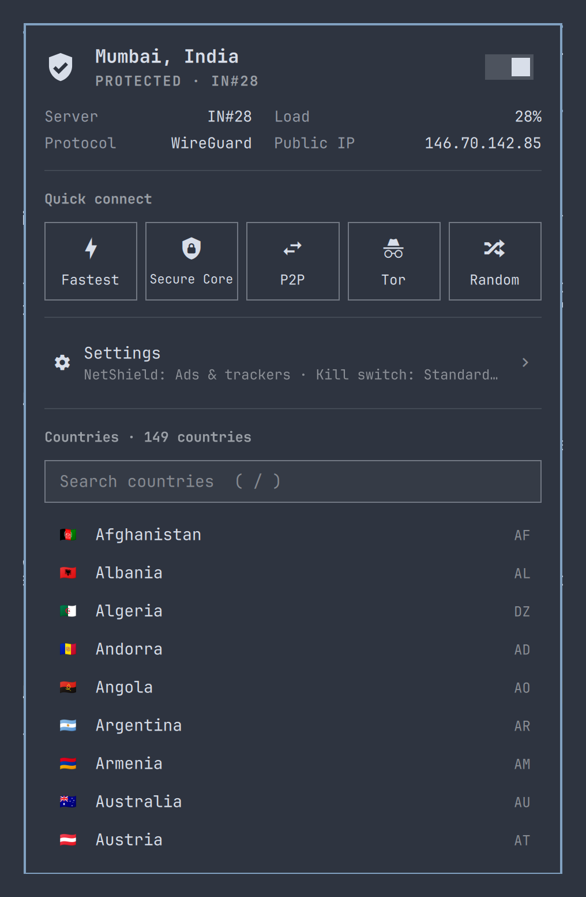

# Proton VPN for Omarchy

An unofficial Omarchy bar widget for [Proton VPN](https://protonvpn.com), built on Proton's official `protonvpn` command-line app.



## Features

- A shield in the bar: solid with a check when connected, hollow when not, breathing while it connects. It can show the country code beside it.
- Left-click opens a panel with the server, location, load, protocol and IP address.
- Quick connects: Fastest, Secure Core, P2P, Tor and Random.
- A searchable list of every Proton country. Pick one to connect to its fastest server, or open it to choose a city, with each city's P2P and Tor support shown.
- Settings for NetShield, kill switch, port forwarding, VPN Accelerator, Moderate NAT and IPv6.
- Right-click toggles the VPN: fastest server, or disconnect.
- Optional notifications when a connect or disconnect started from the widget finishes or fails.
- Follows the Omarchy theme. The bar follows NetworkManager. `protonvpn status` only runs after the tunnel changes, after an action, and on a slow timer while the panel is open. The CLI reads your session from the keyring on every run, and polling it constantly has been reported to crash gnome-keyring.
- Errors from the CLI show in the panel instead of being hidden.

## Requirements

- Omarchy (Quattro shell)
- Proton's official CLI, signed in:

  ```sh
  omarchy pkg add proton-vpn-cli
  protonvpn signin
  ```

- NetworkManager and `nmcli`, which Omarchy ships
- `wl-copy`, to copy the IP address

The widget never asks for your Proton password. Sign in once with `protonvpn signin`.

## Install

```sh
omarchy plugin add https://github.com/orcawhisperer/omarchy-protonvpn --enable
```

To place it in the bar, for example just before Tailscale:

```sh
omarchy bar move io.github.orcawhisperer.protonvpn --section right
```

## Use

| Where | Key or click | Action |
|---|---|---|
| Bar | Left-click | Open the panel |
| Bar | Right-click | Connect to the fastest server, or disconnect |
| Bar | Middle-click | Refresh |
| Panel | `j` / `k` or arrows | Move the cursor |
| Panel | `Enter` / `Space` | Activate the selected item |
| Panel | `l` / `→` on a country | Show its cities |
| Panel | `h` / `←` in a country | Hide its cities |
| Panel | `/` | Search countries |
| Panel | `t` | Connect or disconnect |
| Panel | `c` | Copy the IP address |
| Panel | `r` | Refresh |
| Panel | `Esc` | Close |

To toggle from a keybinding, add this to `~/.config/hypr/bindings.lua`:

```lua
o.bind("SUPER + ALT + V", "Toggle Proton VPN", "omarchy-shell io.github.orcawhisperer.protonvpn toggleVpn")
```

The widget also answers `open`, `close`, `connect`, `connectCountry <CC>`, `showCities <CC>`, `disconnect`, `refresh` and `status` through `omarchy-shell io.github.orcawhisperer.protonvpn <method>`.

## Omarchy DNS and NetShield

Omarchy's DNS setting (`omarchy dns Cloudflare` or `Google`) overrides the DNS of every connection, the VPN's included. While it's set, Proton's resolver isn't used, so **NetShield can't block anything** and Cloudflare or Google still sees your lookups (through the tunnel).

Pick one of these:

- **Recommended:** install the NetworkManager hook in `extras/`. It hands DNS to Proton while the tunnel is up and leaves Omarchy's DNS alone otherwise:

  ```sh
  sudo install -m 755 extras/50-protonvpn-dns /etc/NetworkManager/dispatcher.d/
  ```

  Then reconnect. `resolvectl status proton0` should list `10.2.0.1` with the domain `~.`. To remove the hook, delete that file.

- Or run `omarchy dns DHCP`. Proton's DNS then works on the VPN, but off the VPN your lookups go to your router or ISP.

The hook is optional and never installed automatically.

## Limitations

These come from Proton's CLI (version 1.0.5):

- **Protocol:** WireGuard only. Stealth and OpenVPN are in Proton's GTK app, and the CLI can't run alongside that app.
- **Split tunneling:** not offered. The CLI has no command for it, and Proton's own code only applies split tunneling when the kill switch is off.
- **Kill switch:** only Off and Standard; the CLI has no Advanced mode. It can only be changed while disconnected.
- **Settings that need a reconnect:** changes to IPv6 and custom DNS apply on the next connect.
- **Public IP:** shown after a connect made from the widget. Otherwise the panel shows the server's address.

## Remove

```sh
omarchy plugin remove io.github.orcawhisperer.protonvpn
```

If you installed the DNS hook, also remove it:

```sh
sudo rm /etc/NetworkManager/dispatcher.d/50-protonvpn-dns
```

## Development

`node tests/Model.test.js` runs the parser tests.

## License

MIT. Proton VPN is a trademark of Proton AG. This project is not affiliated with or endorsed by Proton.
